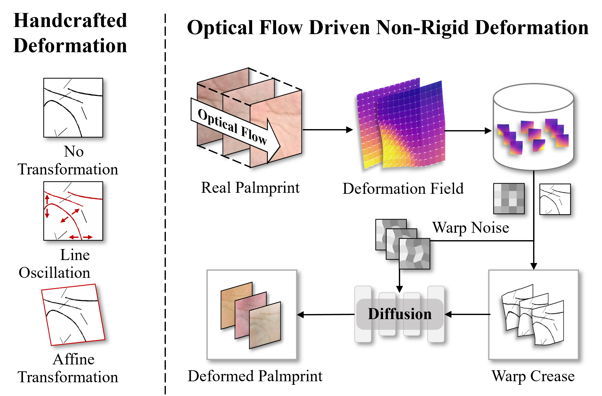

# FlowPalm: Optical Flow Driven Non-Rigid Deformation for Geometrically Diverse Palmprint Generation

<p align="center">
  
  <a href="https://yuchenzou.github.io/FlowPalm/">
    
  </a>
  <a href="https://arxiv.org/abs/2604.09989">
    
  </a>
</p>

FlowPalm is an optical-flow-driven palmprint generation framework for synthesizing geometrically diverse and identity-consistent palmprints. Instead of relying only on style translation or handcrafted transformations, FlowPalm estimates non-rigid deformation priors from real palmprint pairs and injects them into diffusion sampling.

<p align="center">
  
</p>

## Repository Layout

```text
.
├── configs/             # JSON configs for generation and training workflows
├── data/                # PalmDataset and related loaders
├── models/
│   ├── diffusion_model/ # Core diffusion model, attention, PCEM, and FID helpers
│   ├── optical_flow/    # RAFT-based optical flow wrapper
│   └── recognition/     # Recognition backbone used for flow quality filtering
├── scripts/
│   ├── train/           # Diffusion training entrypoint
│   ├── inference/       # Palmprint generation entrypoint
│   └── PolyCreases/     # Synthetic crease map generation
├── tools/
│   └── flow/            # Offline optical flow generation
├── checkpoints/         # Default pretrained weights used by configs
├── outputs/             # Default generated flows, crease maps, and samples
├── gen_flow.sh          # Build deformation priors
├── syn_line.sh          # Generate synthetic crease maps
└── syn_palm.sh          # Generate FlowPalm palmprint samples
```

## Installation

Python 3.10+ is recommended.

```bash
pip install -r requirements.txt
```

The default configs expect the following checkpoints:

```text
checkpoints/flowpalm.pt
checkpoints/recognize_weight.pth
```

## Pretrained Weights

Download the pretrained weights from [Google Drive](https://drive.google.com/drive/folders/1xyEzHIOQOTuK0pktvexeH1p_H6QWLxLX), then place them under `checkpoints/` as shown above. Checkpoint files are intentionally excluded from this repository.

## Quick Start

Run all commands from the repository root.

### 1. Build Optical Flow Priors

Edit `configs/gen_flow.json`, especially `input_dir`, before running. The input directory should contain identity subfolders, each with multiple palmprint images.

```bash
bash gen_flow.sh configs/gen_flow.json
```

By default, filtered deformation fields are saved to `outputs/flow`.

### 2. Generate Synthetic Crease Maps

Edit `configs/syn_line.json` to set the number of synthetic identities and worker processes.

```bash
bash syn_line.sh configs/syn_line.json
```

By default, crease maps are saved to `outputs/line`.

### 3. Generate Palmprint Images

Edit `configs/sample_palm.json` to set checkpoint paths, flow paths, crease paths, and sampling parameters.

```bash
bash syn_palm.sh configs/sample_palm.json
```

By default, generated palmprint samples are saved to `outputs/palm_samples`.

## Training

Edit `configs/train_crease.json`, then run:

```bash
python scripts/train/train_crease_diffusion.py --config configs/train_crease.json
```

## Acknowledgements

This repository builds on ideas and reference implementations from several excellent open-source projects:

- The PCEM-related components refer to [PCE-Palm](https://github.com/Ukuer/PCE-Palm).
- The PolyCreases synthesis components refer to [Diff-Palm](https://github.com/Ukuer/Diff-Palm).
- The noise warping implementation refers to [Go-with-the-Flow](https://github.com/Eyeline-Labs/Go-with-the-Flow).

## Citation

If you find this project useful, please cite:

```bibtex
@inproceedings{zou2026flowpalm,
  title     = {FlowPalm: Optical Flow Driven Non-Rigid Deformation for Geometrically Diverse Palmprint Generation},
  author    = {Zou, Yuchen and Shao, Huikai and Fang, Lihuang and Xiong, Zhipeng and Zhong, Dexing},
  booktitle = {Proceedings of the IEEE/CVF Conference on Computer Vision and Pattern Recognition},
  year      = {2026}
}
```

## License

This project is released under the [MIT License](LICENSE).
